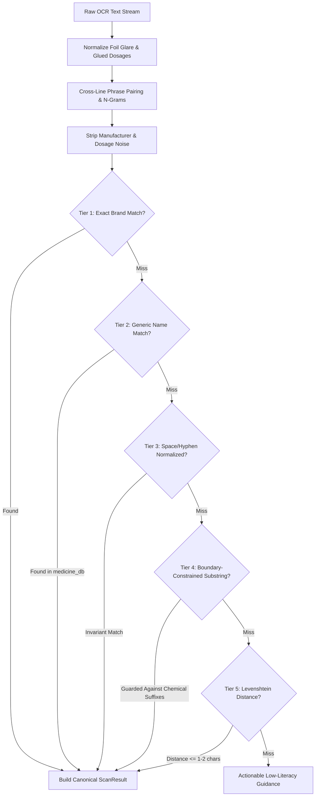

# Ki Oushodh (কী ওষুধ)
### *Offline Mobile Assistive Healthcare System for Medicine Identification for elderly, visual impaired and low literacy users*

<p align="center">
  
</p>

[-3DDC84?logo=android&logoColor=white&style=for-the-badge)](https://github.com/meawsin/ki_oushodh/releases/latest/download/ki-oushudh-v1.1.0.apk)
[](https://github.com/meawsin/ki_oushodh/releases)

[](https://flutter.dev)
[](https://dart.dev)
[](#academic-impact--sustainable-development-goals)

---

## Download App (Direct Android Install)
1. Tap **[Direct Download](https://github.com/meawsin/ki_oushodh/releases/latest/download/ki-oushudh-v1.1.0.apk)** on your Android device.
2. Open `ki-oushudh-v1.1.0.apk` from your Downloads and tap **Install** (*enable "Install Unknown Apps" if prompted*).
3. Open **কী ওষুধ**, grant camera permission, and scan any medicine packaging, blister packet, or pick an image from your gallery!

---

## Summary

**Ki Oushodh** (Bengali: *কী ওষুধ*, meaning *"What Medicine?"*) is an offline-first assistive healthcare application, built specifically for low-literacy individuals, visually impaired populations, and elderly patients in Bangladesh and the Global. 

In low- and middle-income countries, medication identification errors is one of the leading causes of drug toxicity, accidental overdose, and compliance problems. The labeling on the blisters usually comprises of very small, Latin typefaces, reflective aluminum foils, complex chemical names, and poor packaging contrasts. Traditional mHealth solutions fail this demographic because they depend on high-speed internet connectivity, English textual literacy, and complex tactile navigation.

Ki Oushodh addresses this health equity gap through **Zero-Click Auditory Literacy**:
1. **Camera or Gallery Input**: Users point their smartphone camera at any pharmaceutical packaging or import an existing photo from their device gallery.
2. **On-Device Quantized Computer Vision**: An on-device optical character recognition neural network isolates and transcribes degraded pharmaceutical text without sending visual data to remote servers.
3. **Blister Glare & Foil Heuristics**: Deterministic signal filters normalize optical glare, glued dosages (`Napa500`), spaced characters (`S E C L O`), and multi-line drug names (`Napa` + `Extend`).
4. **Offline Clinical Expert Matching**: A 5-tier fuzzy string distance algorithm queries a bundled offline knowledge base of **13,929 Bangladeshi pharmaceutical brands** and **1,640 generics** registered with the Directorate General of Drug Administration (DGDA).
5. **Vernacular Auditory Synthesis**: Clinical indications and precautions are translated into culturally adapted, jargon-free Bengali and delivered immediately using on-device Text-to-Speech (TTS) with customizable speech pacing.
6. **Offline Manual Search**: Users who already know a name or have cut packaging can query the DGDA index offline.

---

## User Interface & Application Screenshots

<p align="center">
  
  &nbsp;&nbsp;
  
  &nbsp;&nbsp;
  
</p>
<p align="center">
  <em>Figure 1: (Left) Home Screen: Camera Scanne, Gallery & Search shortcuts; (Center) Offline Manual Search with quick chips; (Right) Instant sub-millisecond candidate results.</em>
</p>

<p align="center">
  
  &nbsp;&nbsp;
  
  &nbsp;&nbsp;
  
</p>
<p align="center">
  <em>Figure 2: (Left) Identified Medicine Result with TTS, safety precautions, and Medical AI Disclaimer banner; (Center) Accessibility Settings with Voice Speed slider; (Right) Offline DGDA Database compendium sheet.</em>
</p>

<p align="center">
  
  &nbsp;&nbsp;
  
  &nbsp;&nbsp;
  
</p>
<p align="center">
  <em>Figure 3: (Left) Clinical Safety & Emergency 999 Guidance Bottom Sheet; (Center) Native Android photo picker for gallery scanning; (Right) Encrypted local scan history with audio replay.</em>
</p>

---

## Ki Oushodh Processing Pipeline

```
┌──────────────────────────────────────────────────────────────────────────────────────────────────┐
│                               KI OUSHODH PROCESSING PIPELINE                                     │
│                                                                                                  │
│                               [ Camera Feed / Gallery Image ]                                    │
│                                                 │                                                │
│                                                 ▼                                                │
│   ┌──────────────────────────────────────────────────────────────────────────────────────────┐   │
│   │  STAGE 1: EDGE ARTIFICIAL INTELLIGENCE (Quantized Deep Learning Computer Vision)         │   │
│   │  • Model: Google ML Kit Latin Text Recognition (TFLite / Android NNAPI Native Runtime)   │   │
│   │  • Computation: Quantized Convolutional Feature Extractors + BiLSTM / Transformer CTC    │   │
│   │  • Location: 100% On-Device (SoC DSP/NPU/CPU), Zero Cloud Visual Streaming               │   │
│   │  • Task: Raw pixel matrix → Bounding polygon coordinates & transcribed character stream  │   │
│   └─────────────────────────────────────────────┬────────────────────────────────────────────┘   │
│                                                 │                                                │
│                                                 ▼                                                │
│   ┌──────────────────────────────────────────────────────────────────────────────────────────┐   │
│   │  STAGE 2: CLINICAL PRE-PROCESSING & BLISTER PACK FOIL NORMALIZATION                      │   │
│   │  • Foil Glare Restoration: "0meprazole" → "Omeprazole", "Sec1o" → "Seclo"                │   │
│   │  • Glued Dosage Boundary Separation: "Napa500" → "Napa 500", "500mg" → "500 mg"          │   │
│   │  • Spaced Lettering Reconstruction: "S E C L O" → "SECLO"                                │   │
│   │  • Pharmaceutical Signal Gating: Validates medicine markers, rejects non-medicine items  │   │
│   └─────────────────────────────────────────────┬────────────────────────────────────────────┘   │
│                                                 │                                                │
│                                                 ▼                                                │
│   ┌──────────────────────────────────────────────────────────────────────────────────────────┐   │
│   │  STAGE 3: DETERMINISTIC CLINICAL KNOWLEDGE ENGINE (Zero Hallucination Matching)          │   │
│   │  • Database: Bundled 13,929 DGDA Brands & 1,640 Generics in local memory-resident index  │   │
│   │  • 5-Tier Algorithmic Fallback: Exact Brand → Generic DB → Space-Invariant →             │   │
│   │    Guarded Substrings → Dynamic Levenshtein Distance (Threshold: 1-2 edits)              │   │
│   │  • Why NOT a Generative LLM? Eliminates clinical hallucination risk; sub-10ms query      │   │
│   │    latency; runs with < 85MB RAM on budget Snapdragon 625 devices without throttling     │   │
│   └─────────────────────────────────────────────┬────────────────────────────────────────────┘   │
│                                                 │                                                │
│                                                 ▼                                                │
│   ┌──────────────────────────────────────────────────────────────────────────────────────────┐   │
│   │  STAGE 4: VERNACULAR AUDITORY SYNTHESIS (Zero-Click Human-Computer Interaction)          │   │
│   │  • Phonetic Transliteration: "Napa Extend" → "নাপা এক্সটেন্ড", "Ace Plus" → "এস প্লাস"       │   │
│   │  • Low-Literacy Cognitive Compression: Max 2 concise Bengali sentences (no raw mg math)  │   │
│   │  • Native Android TTS: Calibrated pitch (0.94) & adjustable speed (0.30x–0.70x)          │   │
│   └──────────────────────────────────────────────────────────────────────────────────────────┘   │
└──────────────────────────────────────────────────────────────────────────────────────────────────┘
```

---

## The 5-Tier Algorithmic Fuzzy Search Pipeline

Blister packaging is often crumpled, shiny, or stamped with batch numbers and company names. To accurately match medicines offline under real-world noise, Ki Oushodh processes extracted tokens through a 5-tier fuzzy search engine:



1. **Tier 1 — Exact Brand Match**: $O(1)$ constant-time lookup in the 13,929 DGDA commercial brand index.
2. **Tier 2 — Generic Name Match**: Matches generic packaging directly (e.g. government hospital strips labeled *Paracetamol*).
3. **Tier 3 — Space & Hyphen Normalization**: Resolves packaging format differences (`A-Cold` vs `A Cold`, `E-Cap` vs `ECap`).
4. **Tier 4 — Boundary-Constrained Substring**: Matches multi-word brands while blocking generic suffixes (`acid`, `plus`, `oil`, `gel`) to avoid false-positive collisions.
5. **Tier 5 — Dynamic Levenshtein Distance**: Uses edit distance thresholds (1 edit for 4–6 characters, $\le 2$ for 7+ characters) to recover from damaged foil OCR typos (`SecIo` $\rightarrow$ `Seclo`).

---
## Repository Structure

```
ki_oushodh/
├── android/                   # Native Android configuration
├── assets/
│   ├── data/
│   │   ├── brand_index.json   
│   │   └── medicine_db.json   
│   └── images/
│       ├── app_icon.png       
│       └── Ki_oushodh_banner.png 
├── lib/
│   ├── core/
│   │   ├── constants/         # BnTranslations, categories, regex filters
│   │   ├── theme/             
│   │   └── utils/             
│   ├── data/
│   │   └── local/             # Hive NoSQL database initialization
│   ├── domain/
│   │   └── models/            # ScanResult, ScanHistoryModel, ScanHistoryModelAdapter
│   ├── features/
│   │   ├── history/          
│   │   ├── results/           # Audio playback, category chips, clipboard share, Disclaimer
│   │   ├── scanner/           # Preview, gallery picker, OCR trigger, thermal pause
│   │   ├── search/            # Offline manual search, debounced querying, suggestion chips
│   │   └── settings/          # Font scaling, contrast toggle, speech rate slider
│   └── services/
│       ├── camera_service.dart # Camera and flash/autofocus controls
│       ├── search_service.dart # 5-tier fuzzy search engine, foil glare & blister heuristics
│       ├── ocr_service.dart    # Google ML Kit wrapper & pharmaceutical signal validator
│       ├── storage_service.dart# Hive persistence layer
│       └── tts_service.dart    # Calibrated low-literacy TTS audio synthesis & phonetics
├── screenshots/               
└── test/
    ├── blister_ocr_test.dart       # Blister packaging foil glare & glued dosage tests
    ├── diagnose_feedback_test.dart # Physical blister test validation (Napa Extend, Entacyd Plus)
    ├── medicine_search_test.dart   # Unit test suite for matching, transliteration & speech
    └── widget_test.dart            # Flutter widget sanity test
```

---

## Verification & Testing

The project includes an automated test suite across candidate extraction, string distance calculations, blister packet edge cases, category classification, and phonetic naturalness:

```bash
# Execute entire test suite
flutter test
```

### Verified Test Suites:
1. **`test/medicine_search_test.dart`**: Validates brand index lookups, transliteration, therapeutic categories, and bilingual `spokenText` generation.
2. **`test/blister_ocr_test.dart`**: Tests recovery from foil glare character substitutions, glued dosages (`Napa500`), hyphenated forms (`Seclo-20`), spaced lettering (`S E C L O`), and validation guards.
3. **`test/diagnose_feedback_test.dart`**: Validates multi-line blister pack recognition for **Napa Extend** (7 variations), **Entacyd Plus** (6 variations), and **MaxOmega** (6 variations) ensuring zero clinical English leakage and low-literacy dosage phrasing.

```bash
# Run code analysis (must report 0 issues)
flutter analyze
```

---

## Installation & Testing on Other Devices

You can install and test Ki Oushodh on any physical Android device without needing Flutter, an IDE, or developer tools installed on that device.

### Option A: Download from GitHub Releases (Quickest)
Directly download the pre-built standalone APK to your phone:
- **[Download ki-oushudh-v1.1.0.apk](https://github.com/meawsin/ki_oushodh/releases/latest/download/ki-oushudh-v1.1.0.apk)** *(84.6 MB)*
- Or browse all releases on the **[GitHub Releases Page](https://github.com/meawsin/ki_oushodh/releases)**.

### Option B: Build the Release APK Locally
If building from source, run:
```bash
flutter build apk --release
```

The compiled standalone release APK is generated at:
```
build/app/outputs/flutter-apk/app-release.apk
```

---

## Security, Privacy & Ethics

1. **Zero Telemetry**: Ki Oushodh does not collect, transmit, or monetize patient scanning habits, location data, or device identifiers.
2. **Ephemeral Image Processing**: Camera frames and gallery bitmaps are processed in volatile memory and immediately deleted after text extraction. No medical images are ever written to persistent storage.
3. **Clinical Safety & Medical Disclaimer**: Ki Oushodh is an assistive identification aid designed to empower patient autonomy and eliminate health illiteracy; it does not prescribe medications, calculate therapeutic dosages, or substitute for licensed clinical diagnosis by a registered physician.

---

## License

This project is licensed under the **MIT License** — see the [LICENSE](LICENSE) file for details.

